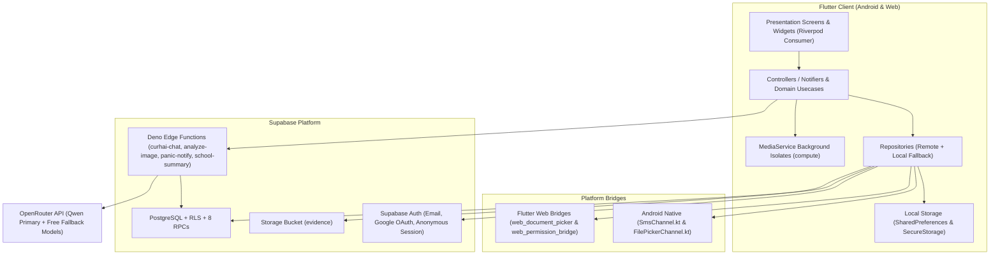

# KitaTemani

*Platform Digital untuk Pencegahan, Pendampingan, dan Pelaporan Perundungan (Bullying) di Lingkungan Sekolah*

**Tagline fungsional:** *Aman untuk bercerita, mudah untuk melapor, cepat untuk dibantu.*

`KitaTemani` (`kitatemani` v`0.1.0+1`) adalah aplikasi **Flutter (Dart 3)** lintas platform (**Android** `minSdk 24` & **Flutter Web**) yang terintegrasi penuh dengan **Supabase** (Auth, PostgreSQL + Row Level Security, RPC, Storage, Realtime, dan Deno Edge Functions) serta **OpenRouter AI** (prioritas model **Qwen** dengan fallback otomatis ke model gratis). Aplikasi ini juga dilengkapi mekanisme *local persistence fallback* sehingga dapat langsung dijalankan untuk pengujian UI/UX maupun pengembangan tanpa perlu setup backend terlebih dahulu.

---

## Daftar Isi

1. [Gambaran Umum & Peran Pengguna](#gambaran-umum--peran-pengguna)
2. [Fitur Utama](#fitur-utama)
3. [Arsitektur Sistem & Tech Stack](#arsitektur-sistem--tech-stack)
4. [Struktur Direktori Proyek](#struktur-direktori-proyek)
5. [Prasyarat Lingkungan (Prerequisites)](#prasyarat-lingkungan-prerequisites)
6. [Panduan Instalasi & Cara Start (Menjalankan Aplikasi)](#panduan-instalasi--cara-start-menjalankan-aplikasi)
   - [Langkah 1 — Clone Repository & Install Dependencies](#langkah-1--clone-repository--install-dependencies)
   - [Langkah 2 — Konfigurasi Environment (`env/dev.json`)](#langkah-2--konfigurasi-environment-envdevjson)
   - [Langkah 3A — Cara Start Cepat (Mode Lokal / Offline Fallback)](#langkah-3a--cara-start-cepat-mode-lokal--offline-fallback)
   - [Langkah 3B — Cara Start Fullstack dengan Supabase & AI](#langkah-3b--cara-start-fullstack-dengan-supabase--ai)
   - [Langkah 4 — Build Produksi (Android & Web)](#langkah-4--build-produksi-android--web)
7. [Daftar Route, RPC & Edge Functions](#daftar-route-rpc--edge-functions)
8. [Izin Android & Jembatan Native / Web](#izin-android--jembatan-native--web)
9. [Pengujian, Linting & CI/CD](#pengujian-linting--cicd)
10. [Keamanan, Privasi & Git Ignore Policy](#keamanan-privasi--git-ignore-policy)
11. [Troubleshooting](#troubleshooting)
12. [Dokumentasi Tambahan](#dokumentasi-tambahan)

---

## Gambaran Umum & Peran Pengguna

Aplikasi memisahkan antarmuka dan hak akses (*Role-Based Access Control* / RBAC) menjadi **2 peran utama** berdasarkan `UserRole` di `profiles` dan tabel `staff`:

| Peran (`wireValue`) | Label UI | Tab Navigasi Utama | Akses & Kemampuan |
| :--- | :--- | :--- | :--- |
| `siswa` | Siswa | **Beranda**, **Curhai**, *(FAB SOS)*, **Laporan**, **Profil** | Melapor kejadian perundungan, mengakses ruang obrolan CurhAI, memicu Tombol Darurat (SOS), mengelola kontak darurat, dan membaca artikel edukasi. |
| `guru_bk` | Guru BK | **Dashboard**, **Pantau** *(Laporan & Panic Button)*, **Artikel**, **Profil** | Melihat & menindaklanjuti seluruh laporan sekolah beserta identitas pelapor (terisolasi per sekolah), memperbarui status laporan, memantau & menandai selesai *Panic Alert*, melihat *Insight AI Sekolah*, serta CRUD artikel edukasi. |

---

## Fitur Utama

### 1. Splash, Onboarding Izin & Autentikasi Sekolah
- **Splash Screen (`/`):** Pemeriksaan awal sesi & rute tujuan.
- **Onboarding Izin (`/onboarding`):** Penjelasan ramah pengguna sebelum meminta izin runtime (**SMS**, **Lokasi GPS**, **Mikrofon**, **Kamera**, **Telepon**) lengkap dengan jembatan status untuk **Flutter Web** (`web_permission_bridge_web.dart`).
- **Masuk & Daftar (`/school-login`):**
  - Autentikasi **Email & Password** (mode Masuk dan Daftar akun).
  - **Google OAuth** dengan *deep link* callback `id.kitatemani://login-callback`.
  - **Mode Tamu / Lanjutkan Biodata** untuk pengisian profil awal di `/complete-profile` serta pemilihan sekolah mitra dari tabel `schools` (default seed: `SMAN 1 Nusantara` / `sman1-nusantara`).

### 2. Beranda Adaptif
- **Tampilan Siswa:** Sapaan personal, hero banner pelaporan ke Guru BK, ringkasan status laporan terbaru dengan stepper progres, akses cepat **CurhAI**, dan pratinjau artikel **Ruang Baca**.
- **Dashboard Konselor (Staf/Guru BK):** Statistik agregat status laporan (*Dikirim*, *Dibaca*, *Ditindak*, *Selesai*), 3 laporan terbaru yang perlu ditinjau, pintasan kelola artikel, dan tautan cepat ke **Insight Sekolah & Panel Guru BK**.

### 3. Pelaporan Perundungan (3 Langkah), Laporanku & Detail Laporan
Alur terstruktur untuk memastikan laporan lengkap, idempoten, dan tahan gangguan sinyal:
- **Langkah 1 (`/reports/new/type` — Jenis & Konteks):**
  - Pilihan peran pelapor (*Aku yang mengalami* sebagai Korban atau *Aku melihat kejadian* sebagai Saksi).
  - Pilihan satu atau lebih jenis perundungan (`BullyingType`): **Fisik**, **Verbal**, dan **Siber**.
  - Tanggal kejadian & lokasi kejadian.
- **Langkah 2 (`/reports/new/story` — Cerita & Lampiran):**
  - 3 input teks sinkron: **Cerita Kejadian** (min. 10 karakter), **List Nama Pelaku**, dan **Nama Korban**.
  - Upload dokumen pendukung format **PDF** atau **DOCX** dengan batas maksimal **2 MB** (diunggah ke Supabase Storage bucket `evidence`, dilengkapi picker native Android & Web).
  - Penambahan **Tautan Bukti** (mendukung deteksi otomatis **YouTube** termasuk thumbnail & dialog pemutar, **Google Drive**, tautan video langsung `.mp4`/`.webm`/`.mov`, dan tautan web umum).
- **Langkah 3 (`/reports/new/review` & `/reports/new/sent`):**
  - Tinjauan seluruh isian sebelum dikirim menggunakan `idempotency_key` (UUID v4) agar pengiriman ulang tidak membuat duplikat, menghasilkan kode unik `KT-XXXX-XXXX`.
  - **Antrean Offline Otomatis:** Saat internet terputus, laporan tersimpan lokal dan dikirim ulang otomatis ketika koneksi kembali.
- **Laporanku / Pantau (`/reports`) & Detail Laporan (`/reports/detail`):**
  - Filter status (**Semua**, **Dikirim**, **Dibaca**, **Ditindak**, **Selesai**); khusus Guru BK dilengkapi 2 tab pemantauan (**Laporan** dan **Panic Button**).
  - Kartu laporan seragam dengan **StatusStepper 4 tahap** (*Dikirim* -> *Dibaca* -> *Ditindak* -> *Selesai*).
  - Halaman detail menampilkan seluruh field sinkron (identitas pelapor, cerita kejadian, nama pelaku, nama korban / fallback `"Belum disebutkan"` bila saksi tidak mengisi, dokumen, tautan bukti interaktif, dan riwayat perubahan status).

### 4. Tombol Darurat (Panic Button)
Dirancang untuk respons cepat di situasi berisiko:
- **Pemicuan Aman (`/panic`):** Tahan tombol SOS selama **2 detik** -> masuk masa jeda pembatalan **5 detik** (dapat dibatalkan atau langsung dikirim) + pilihan tag konteks situasi & catatan area opsional.
- **Eksekusi Paralel (`/panic/active`):**
  1. Mengambil koordinat GPS presisi melalui `Geolocator`.
  2. Merekam audio sekitar berformat `.m4a` menggunakan `record` dan mengunggah hasilnya saat sesi darurat dihentikan (`resolve_panic_event`).
  3. Mengirim SMS darurat langsung melalui channel native Android `SmsChannel.kt` (`SmsManager`) ke seluruh kontak keluarga aktif.
  4. Mengirim peringatan beserta lokasi ke Panel Guru BK melalui Edge Function `panic-notify`.
  5. Menyediakan tombol aksi cepat **Chat WA** (pesan darurat & link koordinat GPS terisi otomatis) dan **Hubungi** ke Kontak Utama, kontak darurat lain, dan Guru BK.

### 5. Kamera & Dokumentasi + Live AI
- **Kamera (`/camera`):** Mode **Foto**, **Video**, dan **Live AI** dari pratinjau kamera perangkat atau galeri.
- **Privasi EXIF Otomatis:** Foto yang diambil/dipilih dibersihkan metadata EXIF (lokasi GPS, tipe kamera) di background worker (`compute`) sebelum diunggah.
- **Live AI Visual (`analyze-image`):** Mengirim foto bukti yang sudah dibersihkan ke Edge Function `analyze-image` (OpenRouter Vision) untuk mendeteksi indikasi visual awal beserta disclaimer.

### 6. CurhAI (Pendamping Emosional AI 24/7)
- **Terintegrasi Edge Function `curhai-chat`:** Memberi validasi emosi yang empatik dan langkah aman ringkas (bukan pengganti Guru BK atau psikolog).
- **Multi-Percakapan Gaya ChatGPT/Gemini:** `CurhaiHistorySidebar` mendukung buat obrolan baru, daftar riwayat *Disematkan* & *Terbaru*, pin/unpin, ubah judul, dan hapus satu/semua percakapan.
- **Privasi Riwayat Obrolan:** Seluruh riwayat chat disimpan secara **lokal di perangkat saja**, tidak disinkronkan ke tabel server.
- **Deteksi Risiko Ganda:** Memantau sinyal risiko `normal`, `elevated`, dan `crisis` di sisi klien dan server untuk mengarahkan siswa menekan **Tombol Darurat** bila terdeteksi keadaan berbahaya.

### 7. Ruang Baca & Artikel Edukasi
- **Ruang Baca (`/articles` & `/articles/detail`):** Tab *Untukmu* dan *Disimpan* (*bookmark*), pencarian teks, filter chip topik, indikator progres membaca di bagian atas pembaca artikel, pengatur skala ukuran huruf, serta komentar artikel.
- **Kelola Artikel (`/articles/new`, khusus Staf/Guru BK):** Membuat, menyunting, dan menghapus artikel edukasi (`education_articles`).

### 8. Profil, Kontak Darurat & Panel Guru BK
- **Profil Saya (`/profile` & `/profile/edit`):** Ringkasan statistik nyata (*Laporan*, *Selesai*, *Kontak Aktif*), kelola avatar (preset ilustrasi/maskot atau unggah foto yang di-resize otomatis ke max 320px), edit biodata sekolah/kelas, status kesiapan darurat & **Izin Aplikasi** (`/profile/permissions`), pusat bantuan & hotline **SAPA 129 (KemenPPPA)**, serta tombol keluar akun.
- **Kontak Darurat (`/profile/contacts` & `/profile/contacts/form`):** Menyimpan hingga maksimal **5 kontak keluarga**, memilih tepat 1 **Kontak Utama**, dan mengaktifkan/menonaktifkan penerima pesan darurat.
- **Insight Sekolah & Panel Guru BK (`/school-summary`):** Ringkasan tren kasus 7 hari tanpa membocorkan identitas pelapor via Edge Function `school-summary`, daftar *Panic Alert* aktif lengkap dengan tombol *Tandai Tertangani*, dan filter laporan masuk sekolah.

---

## Arsitektur Sistem & Tech Stack

Kode mengikuti pendekatan **feature-first layered Clean Architecture ringan** (`domain`, `data`, `presentation`) dengan **Riverpod** sebagai state management dan dependency injection.



### Tech Stack (`pubspec.yaml`)

| Kategori | Paket / Teknologi | Versi / Kegunaan |
| :--- | :--- | :--- |
| **Framework & SDK** | Flutter & Dart SDK | Dart `^3.5.0`, Android `minSdk 24`, Flutter Web |
| **State Management & DI** | `flutter_riverpod` | `^2.6.1` |
| **Backend & Database** | `supabase_flutter` | `^2.18.3` (Auth, PostgREST RPC, Storage, Realtime, Functions) |
| **AI Provider** | OpenRouter (`_shared/ai.ts`) | Prioritas `qwen/qwen3.7-flash` + cascade fallback model gratis |
| **Kamera, Gambar & Media** | `camera`, `image_picker`, `image`, `video_player`, `record` | `camera ^0.12.0+2`, `image_picker ^1.2.4`, `image ^4.13.1`, `video_player ^2.9.2`, `record ^6.2.1` |
| **Lokasi, Izin & Komunikasi** | `geolocator`, `permission_handler`, `url_launcher`, `connectivity_plus` | `geolocator ^14.0.1`, `permission_handler ^13.0.2`, `url_launcher ^6.3.3`, `connectivity_plus ^7.3.2` |
| **Penyimpanan Lokal** | `shared_preferences`, `flutter_secure_storage`, `path_provider` | `shared_preferences ^2.5.6`, `flutter_secure_storage ^11.2.0`, `path_provider ^2.1.6` |
| **UI, Font & Aset** | `google_fonts`, `flutter_svg`, `flutter_localizations`, `intl`, `uuid` | `google_fonts ^6.2.1`, `flutter_svg ^2.0.17`, `uuid ^4.6.0` |
| **Testing & Lint** | `flutter_test`, `mocktail`, `flutter_lints` | `mocktail ^1.0.5`, `flutter_lints ^5.0.0` |

### Optimasi Performa Runtime (60–120 FPS)
Codebase telah dioptimalkan menggunakan aturan runtime performance:
- **Background Image Processing (`compute`):** Stripping EXIF, resize avatar, dan encoding base64 pada `MediaService` dijalankan di worker terpisah agar UI thread tidak macet saat capture foto/upload.
- **Isolated Rebuild Scopes:** Penggantian `setState` pada timer 1Hz (`PanicStatusScreen`, `PanicButtonScreen`, timer rekaman `CameraScreen`) dan listener scroll (`ArticleDetailScreen`) dengan `ValueNotifier` + `ValueListenableBuilder`, serta penggunaan `ref.watch(provider.select(...))` secara ketat di layar utama.
- **Lazy Virtualized Lists:** Penggunaan `ListView.builder` pada `MyReportsScreen`, `ArticlesFeedScreen` (dengan `_GroupedCardEdgePainter` tanpa alokasi `Paint` per frame), dan `CurhaiHistorySidebar`.
- **Caching & Bounded Image Decode:** Lazy memoization pada `AppTextStyles`, LRU cache 16-entri untuk decode avatar base64 di `ProfileAvatarWidget`, serta pembatasan `cacheWidth`/`cacheHeight` + `gaplessPlayback: true` pada `Image.memory` dan `Image.network`.
- **Rendering Stability:** Penggunaan `RepaintBoundary` secara selektif pada SVG (`OwlMascot`, `KitaIllustration`), banner hero, progress bar, dan animasi hold SOS, serta penghapusan `Opacity` wrapper pada preview kamera agar tidak memicu `saveLayer`.

---

## Struktur Direktori Proyek

```text
Kita-Temani/
├── .github/workflows/ci.yml        # Pipeline CI: format, analyze, test --coverage
├── android/                        # Konfigurasi Android Gradle & Kotlin channels (id.kitatemani/sms, id.kitatemani/file_picker)
├── assets/
│   ├── illustrations/              # Aset SVG ilustrasi adegan (9 file)
│   └── mascot/                     # Aset SVG maskot burung hantu & app icon (8 file)
├── docs/                           # Arsitektur, kontrak API, onboarding, ADR, dan runbook operasional
├── env/
│   └── dev.example.json            # Template konfigurasi environment (dev.json & .env di-ignore Git)
├── integration_test/
│   └── app_test.dart               # Integration test alur aplikasi
├── lib/
│   ├── main.dart                   # Entry point memanggil bootstrap()
│   ├── bootstrap.dart              # Inisialisasi Supabase opsional + SharedPreferences + ProviderScope
│   ├── app/                        # Tema (app_colors, app_text_styles, app_theme) & AppRouter
│   ├── core/                       # Config (Env, AppFlavor), Result/Failure, services (Media, SMS, GPS, Audio, Bridge Web), widgets
│   ├── l10n/                       # Lokalisasi & copy Bahasa Indonesia terpusat
│   └── features/
│       ├── articles/               # Ruang Baca, bookmark, komentar, CRUD artikel Guru BK
│       ├── auth/                   # Splash, onboarding izin, login sekolah, lengkapi biodata, RBAC
│       ├── camera/                 # Kamera foto/video, EXIF strip, Live AI visual check
│       ├── curhai/                 # Chat AI 24/7, riwayat multi-sesi lokal, deteksi krisis, latihan napas
│       ├── emergency_contacts/     # CRUD hingga 5 kontak keluarga & kontak utama
│       ├── home/                   # Shell tab adaptif Siswa vs Dashboard Konselor
│       ├── panic/                  # Hold SOS 2s + grace 5s, GPS, rekam audio, SMS, panic-notify, WA/Hubungi
│       ├── profile/                # Profil, avatar, status izin real-time, SAPA 129
│       ├── report/                 # Form laporan 3 langkah, antrean offline, Laporanku, Pantau & Detail Laporan
│       └── school_summary/         # Insight AI Sekolah 7 hari & manajemen Panic Alert Guru BK
├── supabase/
│   ├── config.toml                 # Konfigurasi Supabase lokal, Auth deep link, Edge Function flags
│   ├── seed.sql                    # Seed awal sekolah mitra & 10 artikel edukasi resmi Guru BK
│   ├── migrations/                 # 13 file migrasi SQL skema, RLS, RPC & update bertahap
│   └── functions/                  # Edge Functions: curhai-chat, analyze-image, panic-notify, school-summary, _shared
├── test/                           # 24 file unit, widget & TestSprite verification tests
├── testsprite_tests/               # Rencana uji frontend/backend TestSprite & skrip server lokal Web
├── web/                            # Entry point & PWA manifest untuk target Flutter Web
├── analysis_options.yaml           # Aturan analyzer & lint ketat Dart/Flutter
├── pubspec.yaml & pubspec.lock     # Daftar dependensi Flutter terkunci
└── README.md                       # Dokumentasi proyek ini
```

---

## Prasyarat Lingkungan (Prerequisites)

Pastikan lingkungan pengembangan sudah memiliki:
1. **Flutter SDK** (sudah terbundel **Dart `^3.5.0`**) — cek dengan `flutter doctor`.
2. **Untuk target Android:** Android SDK (`minSdk 24` ke atas), emulator atau perangkat Android fisik (disarankan perangkat fisik jika ingin menguji SMS `SmsManager`, kamera langsung, GPS real, dan mikrofon).
3. **Untuk target Web:** Browser **Google Chrome** atau **Microsoft Edge**.
4. **Opsional (hanya untuk mode Fullstack Backend):**
   - Akun & proyek **Supabase** (Cloud) **atau** **Node.js + Docker Desktop** (untuk `npx supabase start` secara lokal).
   - **OpenRouter API Key** untuk menjalankan fitur AI (`curhai-chat`, `analyze-image`, `school-summary`).

---

## Panduan Instalasi & Cara Start (Menjalankan Aplikasi)

### Langkah 1 — Clone Repository & Install Dependencies

```bash
git clone <url-repository-github-anda>
cd Kita-Temani
flutter pub get
```

---

### Langkah 2 — Konfigurasi Environment (`env/dev.json`)

Aplikasi membaca variabel environment saat compile/run melalui `--dart-define` atau `--dart-define-from-file` pada [env.dart](lib/core/config/env.dart):

| Key | Keterangan | Contoh Nilai |
| :--- | :--- | :--- |
| `FLAVOR` | Lingkungan build (`dev`, `staging`, atau `prod`) | `"dev"` |
| `SUPABASE_URL` | URL proyek Supabase (Cloud `https://<ref>.supabase.co` atau lokal `http://127.0.0.1:54321`) | `"https://xxxx.supabase.co"` |
| `SUPABASE_ANON_KEY` | Publishable / Anon Key Supabase | `"eyJhbGci..."` |
| `USE_DUMMY_DATA` | Paksa mode cadangan lokal (`"true"`) atau gunakan Supabase bila terkonfigurasi (`"false"`) | `"false"` |

> **Catatan Logika Startup:** Di `lib/core/config/env.dart`, `useSupabase` otomatis bernilai `false` apabila `SUPABASE_URL` kosong, `SUPABASE_ANON_KEY` kosong, masih berisi placeholder `example.supabase.co`, atau `USE_DUMMY_DATA=true`. Dalam kondisi tersebut, aplikasi langsung memakai repositori lokal tanpa error.

Salin file template agar siap diedit (file `env/dev.json` sudah masuk `.gitignore` dan tidak akan ter-push ke GitHub):

**Windows (PowerShell):**
```powershell
Copy-Item env/dev.example.json env/dev.json
```

**macOS / Linux (Bash/Zsh):**
```bash
cp env/dev.example.json env/dev.json
```

---

### Langkah 3A — Cara Start Cepat (Mode Lokal / Offline Fallback)

Cocok untuk langsung mencoba UI, membuat laporan, menguji CurhAI fallback lokal, simulasi Panic Button, serta dashboard Guru BK **tanpa perlu membuat project Supabase**:

```bash
# Jalankan di Android emulator / HP fisik yang terhubung:
flutter run

# Atau jalankan di browser Chrome / Edge:
flutter run -d chrome
flutter run -d edge

# Memaksa mode lokal meskipun env/dev.json sudah terisi Supabase:
flutter run --dart-define=USE_DUMMY_DATA=true
```

---

### Langkah 3B — Cara Start Fullstack dengan Supabase & AI

#### Opsi 1: Menggunakan Supabase Cloud

1. **Jalankan Migrasi Database & Seed Data**
   Masuk dengan Supabase CLI lalu hubungkan ke proyek Anda, atau jalankan berurutan 13 file SQL pada `supabase/migrations/` di **Supabase SQL Editor** dilanjutkan `supabase/seed.sql`:
   ```bash
   npx supabase login
   npx supabase link --project-ref <project-ref-anda>
   npx supabase db push
   ```
   Urutan file migrasi yang diterapkan:
   - `20261109_reports.sql`
   - `20261120_fullstack_schema.sql`
   - `20261121_general_auth_fix.sql`
   - `20261122_profile_biodata.sql`
   - `20261123_update_counselor_phone.sql`
   - `20261124_panic_rich_context.sql`
   - `20261125_profile_details.sql`
   - `20261126_counselor_rbac_crud.sql`
   - `20261127_report_parties_and_doc_limit.sql`
   - `20261128_report_detail_is_victim.sql`
   - `20261129_fix_my_reports_isolation.sql`
   - `20261130_reset_app_data_and_seed_guru_bk_articles.sql`
   - `20261201_report_reporter_identity.sql`
   - Lalu jalankan `supabase/seed.sql` untuk mengisi sekolah default (`sman1-nusantara`) dan 10 artikel edukasi awal oleh Guru BK.

2. **Set Secret OpenRouter API & Deploy Edge Functions**
   Semua pemanggilan AI (`supabase/functions/_shared/ai.ts`) memakai `OPENROUTER_API_KEY` (atau alias `AI_API_KEY`). Model default adalah `qwen/qwen3.7-flash` dengan fallback otomatis ke model gratis OpenRouter ketika terjadi limit kuota (`402`/`429`).
   ```bash
   # Set API Key OpenRouter (wajib untuk CurhAI, Live AI Kamera, & Insight Sekolah):
   npx supabase secrets set OPENROUTER_API_KEY=<openrouter_api_key_anda>

   # Opsional — ganti model teks / vision atau base URL:
   npx supabase secrets set OPENROUTER_MODEL="qwen/qwen3.7-flash" OPENROUTER_VISION_MODEL="qwen/qwen3.7-flash"

   # Deploy 4 Edge Functions:
   npx supabase functions deploy curhai-chat --no-verify-jwt
   npx supabase functions deploy analyze-image --no-verify-jwt
   npx supabase functions deploy panic-notify --no-verify-jwt
   npx supabase functions deploy school-summary --no-verify-jwt
   ```
   > **Catatan Auth Edge Function:** Pada `supabase/config.toml`, keempat function diset `verify_jwt = false` pada gateway agar mendukung format publishable/ECC token modern, namun setiap request tetap memvalidasi token pengguna secara ketat di server melalui `requireAuthenticatedUser` (`auth.getUser()`) pada `supabase/functions/_shared/supabase.ts`.

3. **Konfigurasi Redirect URL Auth (untuk Google OAuth di Android):**
   Di dashboard **Supabase Auth -> URL Configuration**, tambahkan Redirect URL:
   - `id.kitatemani://login-callback`

4. **Isi `env/dev.json` lalu Start Aplikasi:**
   ```json
   {
     "FLAVOR": "dev",
     "SUPABASE_URL": "https://<project-ref-anda>.supabase.co",
     "SUPABASE_ANON_KEY": "<publishable-atau-anon-key-anda>",
     "USE_DUMMY_DATA": "false"
   }
   ```
   Jalankan:
   ```bash
   # Android:
   flutter run --dart-define-from-file=env/dev.json

   # Flutter Web:
   flutter run -d chrome --dart-define-from-file=env/dev.json
   # atau:
   flutter run -d edge --dart-define-from-file=env/dev.json
   ```

#### Opsi 2: Menggunakan Supabase Lokal (Docker)

1. Pastikan Docker Desktop aktif, lalu jalankan stack lokal Supabase:
   ```bash
   npx supabase start
   ```
   Layanan lokal berjalan pada port sesuai `supabase/config.toml`:
   - **API Gateway:** `http://127.0.0.1:54321`
   - **PostgreSQL DB:** `127.0.0.1:54322`
   - **Supabase Studio:** `http://127.0.0.1:54323`

2. Jalankan Edge Functions secara lokal dengan file environment rahasia (jangan di-commit):
   ```bash
   npx supabase functions serve --env-file env/.env
   ```
   *(Isi `env/.env` dengan `OPENROUTER_API_KEY=...`)*

3. Isi `env/dev.json` dengan `SUPABASE_URL` & `anon key` hasil output `npx supabase status` (untuk Emulator Android, gunakan `http://10.0.2.2:54321`; untuk Flutter Web / Chrome, gunakan `http://127.0.0.1:54321`), lalu jalankan:
   ```bash
   flutter run --dart-define-from-file=env/dev.json
   ```

---

### Langkah 4 — Build Produksi (Android & Web)

```bash
# Build Android APK (release):
flutter build apk --release --dart-define-from-file=env/dev.json

# Build Android App Bundle (.aab) untuk Play Store:
flutter build appbundle --release --dart-define-from-file=env/dev.json

# Build Flutter Web statis (output di folder build/web):
flutter build web --release --dart-define-from-file=env/dev.json
```

Untuk mengetes hasil build web di server lokal (port `8089` sesuai konfigurasi TestSprite):
```bash
python -m http.server 8089 --directory build/web
```

---

## Daftar Route, RPC & Edge Functions

### Route Aplikasi (`lib/app/router/routes.dart`)
| Route | Tujuan Layar |
| :--- | :--- |
| `/` | Splash Screen |
| `/onboarding` | Onboarding & Permintaan Izin Awal |
| `/school-login` | Masuk / Daftar Akun & OAuth |
| `/complete-profile` | Pengisian Biodata & Pemilihan Sekolah |
| `/home` | Shell Navigasi Utama (Siswa / Guru BK) |
| `/reports` | Daftar Laporan (Laporanku / Laporan Masuk Sekolah) |
| `/reports/new/type` | Form Laporan Langkah 1 (Peran Pelapor, Jenis, Tanggal, Lokasi) |
| `/reports/new/story` | Form Laporan Langkah 2 (Cerita, Pelaku, Korban, PDF/DOCX <= 2 MB, Tautan Bukti) |
| `/reports/new/review` | Form Laporan Langkah 3 (Review & Kirim) |
| `/reports/new/sent` | Konfirmasi Terkirim & Kode Tiket `KT-XXXX-XXXX` |
| `/reports/detail` | Detail Laporan, Identitas Pelapor, Lampiran Bukti & Timeline Status |
| `/panic` | Tombol Darurat (Hold 2s + Jeda 5s + Konteks Situasi) |
| `/panic/active` | Layar Darurat Aktif (Timer, GPS, Audio, SMS, Chat WA & Hubungi) |
| `/camera` | Kamera Foto / Video / Live AI + EXIF Removal |
| `/curhai` | Ruang Obrolan CurhAI + Sidebar Riwayat |
| `/articles`, `/articles/detail`, `/articles/new` | Ruang Baca Artikel Edukasi & Composer Guru BK |
| `/profile`, `/profile/edit`, `/profile/permissions` | Profil Saya, Edit Profil & Status Izin |
| `/profile/contacts`, `/profile/contacts/form` | Manajemen Kontak Darurat (maks. 5) |
| `/school-summary` | Insight AI Sekolah & Monitor Panic Alert (Staf/Guru BK) |

### Supabase PostgreSQL RPC & Edge Functions
- **Database RPC (Security Definer + `search_path = public`):**
  - `upsert_my_profile` — Simpan profil & sinkron keanggotaan `staff`.
  - `submit_report` — Simpan laporan idempoten (`p_idempotency_key`, `p_types`, `p_perpetrator_names`, `p_victim_name`, `p_attachments`, dll.) & notifikasi staf.
  - `get_my_reports`, `get_school_reports`, `get_report_detail` — Pengambilan daftar & detail laporan terisolasi RLS.
  - `advance_report_status` & `send_report_message` — Perubahan status berurutan & pesan diskusi 2-arah.
  - `resolve_panic_event` — Penutupan sesi darurat & lampiran storage rekaman audio.
- **Edge Functions (`supabase/functions/`):**
  - `POST /functions/v1/curhai-chat` — Respons empatik CurhAI + `risk_level`.
  - `POST /functions/v1/analyze-image` — Analisis visual indikasi perundungan pada bukti foto.
  - `POST /functions/v1/panic-notify` — Pencatatan `panic_events` & notifikasi darurat ke Guru BK sekolah.
  - `POST /functions/v1/school-summary` — Ringkasan tren laporan 7 hari secara agregat & anonim.

---

## Izin Android & Jembatan Native / Web

Deklarasi di `android/app/src/main/AndroidManifest.xml`:

| Izin Android | Fungsi dalam Aplikasi |
| :--- | :--- |
| `SEND_SMS` | Mengirim SMS darurat langsung lewat `SmsChannel.kt` (`SmsManager`) saat Tombol SOS aktif. |
| `ACCESS_FINE_LOCATION` & `ACCESS_COARSE_LOCATION` | Menyematkan koordinat GPS akurat pada SMS darurat, pesan WhatsApp, dan `panic-notify`. |
| `RECORD_AUDIO` | Merekam audio bukti sekitar (`.m4a`) saat sesi darurat berjalan. |
| `CAMERA` & `READ_MEDIA_IMAGES` / `READ_EXTERNAL_STORAGE` (maxSdk 32) | Mengambil foto/video bukti, memindai Live AI, dan memilih foto profil/dokumen. |
| `CALL_PHONE` | Membuka aksi panggilan darurat ke kontak keluarga / Guru BK. |
| `INTERNET` & `ACCESS_NETWORK_STATE` | Komunikasi Supabase, OpenRouter AI via Edge Functions, dan deteksi mode offline/online. |

**Platform Channel Android (`MainActivity.kt`):**
- `"id.kitatemani/sms"` -> `SmsChannel.kt` (pengiriman SMS native tanpa membuka aplikasi SMS pihak ketiga).
- `"id.kitatemani/file_picker"` -> `FilePickerChannel.kt` (pemilihan dokumen PDF/DOCX untuk lampiran laporan).

---

## Pengujian, Linting & CI/CD

### Perintah Verifikasi Lokal
```bash
# 1. Cek format kode Dart (sama dengan CI):
dart format --output=none --set-exit-if-changed lib test

# 2. Analisis statis (strict lints di analysis_options.yaml):
flutter analyze

# 3. Jalankan seluruh unit, widget & TestSprite schema/E2E suite tests (24 file test):
flutter test

# 4. Jalankan tes dengan laporan coverage:
flutter test --coverage
```

> **Catatan CI (`.github/workflows/ci.yml`):** Setiap *push* dan *pull request* ke branch `main` atau `develop` menjalankan secara otomatis `flutter pub get`, `dart format --output=none --set-exit-if-changed lib test`, `flutter analyze`, dan `flutter test --coverage`.

---

## Keamanan, Privasi & Git Ignore Policy

- **Rahasia & File Konfigurasi Sensitif Di-ignore:** `.gitignore` memblokir `env/.env`, `env/dev.json`, `.env*`, file keystore/sertifikat (`*.jks`, `*.keystore`, `*.p12`, `*.pem`, `*.key`, `key.properties`), `google-services.json`, `GoogleService-Info.plist`, folder sementara `supabase/.temp/`, serta folder desain besar (`interface/`, `interface_redesign/`, `design/`), dokumentasi internal (`md/`), dan folder tooling lokal (`.agents/`, `skills-lock.json`). Hanya template aman `env/dev.example.json` yang diizinkan masuk repository.
- **Row Level Security (RLS):** Isolasi data laporan, lampiran, dan pesan diskusi antar sekolah serta antara siswa pelapor dengan Guru BK.
- **EXIF Metadata Stripping:** Lokasi GPS & identitas perangkat kamera otomatis dihapus dari foto sebelum diunggah ke storage.
- **Penyimpanan Lokal CurhAI:** Riwayat obrolan konseling awal siswa disimpan di perangkat saja, bukan di database server.

---

## Troubleshooting

1. **Aplikasi tidak terhubung ke Supabase meskipun sudah mengubah `env/dev.json`:**
   Pastikan aplikasi dijalankan dengan flag `--dart-define-from-file=env/dev.json` (menjalankan `flutter run` saja tanpa flag akan mengosongkan `SUPABASE_URL` dan otomatis masuk ke mode fallback lokal). Pastikan juga `SUPABASE_URL` tidak lagi berisi `example.supabase.co`.
2. **Fitur CurhAI / Live AI / Insight Sekolah mengembalikan error API (`401` / `402` / `429`):**
   Cek apakah `OPENROUTER_API_KEY` sudah terpasang dengan benar di Supabase Secrets, atau lakukan rotasi API key sesuai [Runbook Rotasi Kunci API OpenRouter](docs/runbooks/rotate-openrouter-key.md).
3. **Kamera / Mikrofon / SMS saat dijalankan di Flutter Web:**
   Pengiriman SMS native (`SmsChannel.kt`) hanya tersedia di **Android**. Di browser (Web), aplikasi menyediakan alur **Chat WA** dan **Hubungi**, sedangkan izin kamera/mikrofon/lokasi dikelola oleh browser lewat `web_permission_bridge_web.dart` (jalankan di `localhost`/`127.0.0.1` atau HTTPS).
4. **Error Google Fonts saat menjalankan `flutter test` tanpa internet:**
   Di test sudah dikonfigurasi `GoogleFonts.config.allowRuntimeFetching = false`, dan `AppTextStyles` melakukan caching secara *lazy* agar aman dijalankan offline pada test runner.

---

## Dokumentasi Tambahan

- [Arsitektur Sistem](docs/architecture.md)
- [Dokumentasi Kontrak API (RPC & Edge Functions)](docs/api.md)
- [Panduan Onboarding Developer](docs/onboarding.md)
- [ADR-001: Flutter untuk Aplikasi Klien](docs/adr/0001-flutter.md)
- [ADR-002: Riverpod untuk State Management dan DI](docs/adr/0002-riverpod.md)
- [ADR-005: Anonimitas by Design pada Tabel Laporan](docs/adr/0005-anonymity-by-design.md)
- [Runbook: Kegagalan Tombol Darurat / SMS](docs/runbooks/panic-failure.md)
- [Runbook: Rotasi Kunci API OpenRouter](docs/runbooks/rotate-openrouter-key.md)
